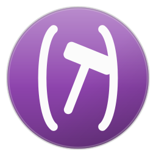

#+title: Colophon
#+author: Josep Bigorra
#+email: jjbigorra@gmail.com
#+language: en
#+options: toc:nil

[[file:index.org][Documentation index]] · [[file:../README.org][README]]

* Colophon

** The mark
:PROPERTIES:
:CUSTOM_ID: the-mark
:END:

The logo at the top of the README is : hand-written
64×64 vector paths, a lambda inside its parentheses, no external assets and no
font downloads, so it renders anywhere the file goes and weighs less than the
sentence describing it.

** The badges
:PROPERTIES:
:CUSTOM_ID: the-badges
:END:

The badges come from the [[https://jointhefreeworld.org/][jointhefreeworld]] glyph
generator: they are SVGs from the project's own site rather than a third-party
badge service, and each one is drawn by the same generator that draws the other
jointhefreeworld projects' badges.

** The text-mode logo
:PROPERTIES:
:CUSTOM_ID: the-text-mode-logo
:END:

The one maak itself prints, for terminals and plain-text readers:

#+begin_src text
 ,---.       ,---.
(     \     /     )
 )  (  \____/  )  (
(    \ @  @ /    )      [ Maak ]
 )    ( oo )    (       The infinitely extensible
(      \__/      )      command runner, control plane,
  `------------'        and project automator.
#+end_src

** The screenshots
:PROPERTIES:
:CUSTOM_ID: the-screenshots
:END:

The picture in the README is a frame from a running Emacs with ~maak.el~
loaded: ~maak-run-task~ over another project's Maak file, with every column —
name, padded arguments, italic docstring — drawn by the package itself rather
than assembled afterwards.

** The guide
:PROPERTIES:
:CUSTOM_ID: the-guide
:END:

This guide is Org — one page per file under ~docs/~ — because the project is Lisp
and its documentation may as well be too: a page is text you can read in Emacs,
diff like code, and export to HTML without a toolchain of its own.
